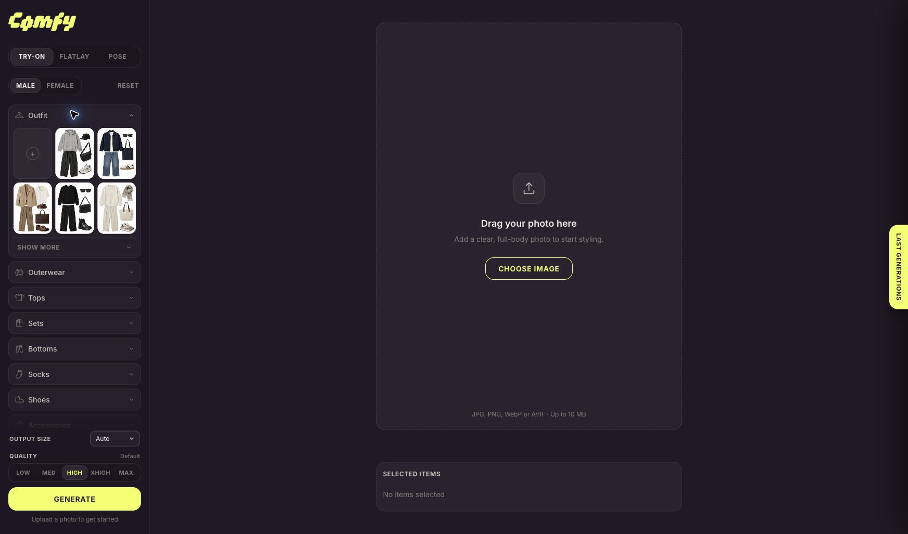
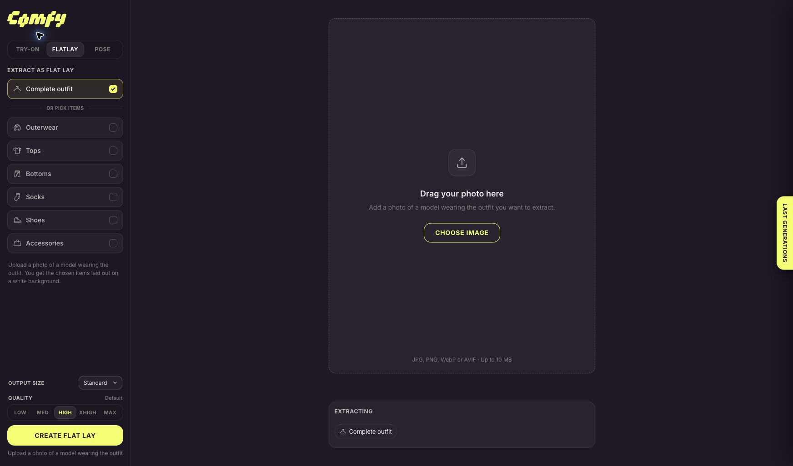
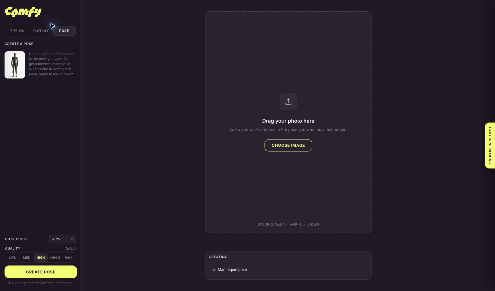
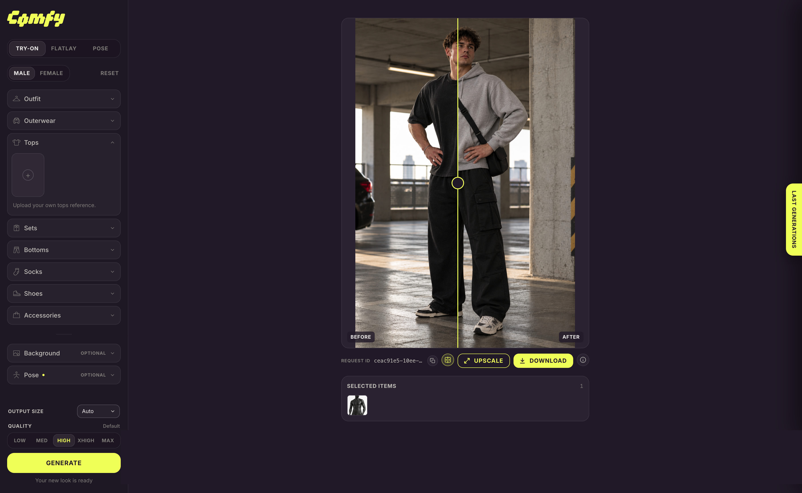

# Comfy Studio — visual walkthrough

Comfy Studio connects three workflows: try on clothes, extract product flat lays and create reusable pose references. All screenshots below are examples from the app, not guarantees of an identical model result.

## 1. Start the app

Follow the [setup instructions](../README.md#getting-started), add your own Comfy key to `.env.local`, and open the local URL. Pick **Try-on** in the sidebar and upload a person photo. JPG, PNG, WebP and AVIF are accepted, up to 10 MB each.

## 2. Select clothing

Choose Male or Female to browse a collection, then expand **Outfit** for built-in presets. Alternatively, upload individual garments under Tops, Bottoms, Shoes and the other categories. Selected tiles appear in **Selected items** below the photo. Click a selected item to inspect it, or remove it with its remove control.

Choose output size and quality, then click **Generate**. Each submission uses your Comfy workspace credits. Do not start another job just because the first one is still queued; its status appears in the workspace and history.

## 3. Extract a flat lay

Switch to **Flatlay**, upload someone wearing an outfit, and choose the complete outfit or specific items. **Create flat lay** requests a product image on white. After it finishes, **Use as …** returns it to the appropriate Try-on category. **Save** keeps a library tile in this browser across reloads.

Each workflow keeps its own uploaded photo, quality and output-size settings.

## 4. Create and apply a pose

Switch to **Pose** and upload a person in the desired posture. **Create pose** requests a faceless black mannequin with that posture and crop. Use or save the result, then select it under **Pose** in Try-on.

For a try-on with a pose, the inputs have different roles:

- Person photo: identity and appearance.
- Garment images: clothes, colors, patterns and design.
- Pose figure: whole-body orientation, posture, camera view, placement and crop.

The prompt requests a new photograph based on the pose composition. A pose ending at the thighs requests the same crop; a full-body figure requests a full-body composition. The model can still interpret details differently; it is not a geometric pose-locking system.

## 5. Compare, upscale and download

After generation, enable the before/after comparison and drag the vertical divider. **Download** saves the result. **Upscale** offers the resolutions supported by the configured upscaler. The **Last Generations** tab opens the last 12 jobs; clicking one restores its inputs and settings.

The slider compares two images in the same display area. When the pose changes composition or aspect ratio, body features may not align across the divider.

## Where your images go

The application sends images to Comfy and the selected model provider to generate results. History and saved library tiles stay in this browser's IndexedDB. Clearing browser storage removes them.
